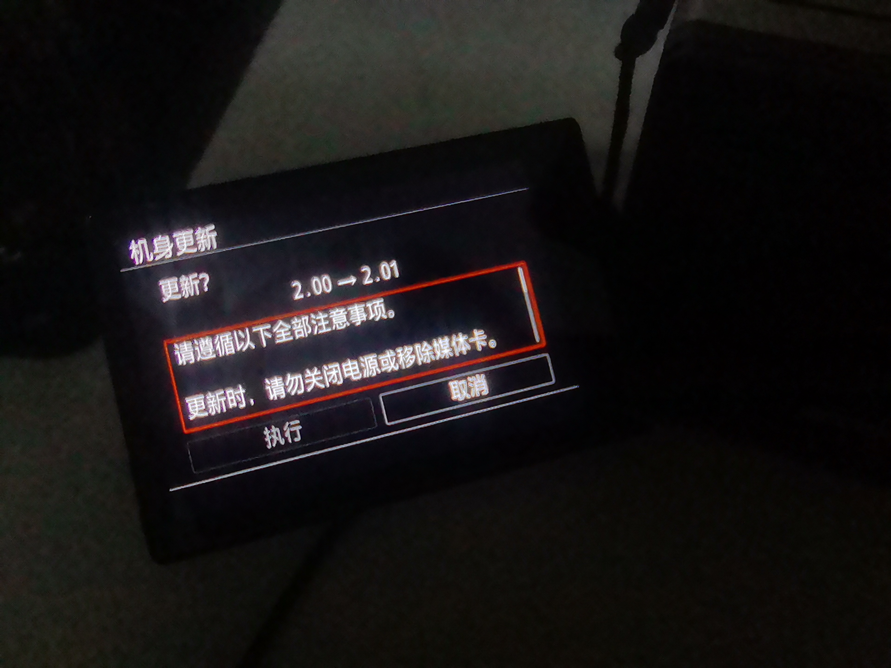

# CXD90057-CST · GitHub 开源方案（中英文对照）

> Open-source release plan for `CXD90057-CST` / 开源发布方案

---

## 1. 仓库基础信息 / Repository Basics

### 仓库名 / Repository Name

```
CXD90057-CST
```

**备选 / Alternative**: `cxd90057-crc-shell-check`（需要时用更长的描述性名字）
**不建议 / Avoid**: `sony-a6700-firmware-hack`（带 hack 字样，容易被自动化审查误判）

### About 描述 / Description

**简短版（推荐，GitHub About 栏）**

```
Sony CXD90057 (BIONZ XR) firmware container, encryption and integrity-layer analysis, with a reproducible offline verifier. No firmware, no flashing instructions.
```

```
索尼 CXD90057（BIONZ XR）固件容器、加密与完整性层分析，附可复现的离线校验器。不含固件，不含刷机指引。
```

**中等版（用于 README 首行）**

```
Documented reverse-engineering of the Sony CXD90057 camera firmware shell (L0 container / L1 CRC32 / L2 tar sums / L3 frame checks), verified on ILCE-6700 2.00. Includes an offline verifier and a real-device identification-layer proof.
```

```
索尼 CXD90057 相机固件「壳」机制的逆向记录（L0 容器 / L1 CRC32 / L2 tar 清单 / L3 帧校验），在 ILCE-6700 2.00 上实测。附离线校验器与真机识别层验证证据。
```

### Topics 标签 / Topics

```
sony  bionz  cxd90057  a6700  ilce-6700  firmware  reverse-engineering
crc32  firmware-analysis  integrity-check  binwalk  elf  aarch64
```

**中文补充说明**：GitHub Topics 只支持英文小写 + 连字符，不要放中文。

---

## 2. 免责声明 / Disclaimer

**这一节必须放在 README 最显眼的位置，并且和 LICENSE 分开。**

### 英文版

```markdown
## Disclaimer

This repository is a **reverse-engineering research record**, not a firmware
modification tool and not a repair service.

- It contains **no Sony firmware**, no decrypted partition images, no private
  keys, and no flashing tools.
- It does **not** provide instructions to flash, downgrade, or unlock any camera.
- All observations come from **offline analysis of officially distributed
  update packages** and from **read-only device queries**.
- Any modification attempt carries a real risk of bricking the device and
  voiding the warranty. The authors assume no liability for such outcomes.
- Trademarks and firmware copyrights belong to Sony Group Corporation.
```

### 中文版

```markdown
## 免责声明

本仓库是**逆向研究记录**，不是固件修改工具，也不是维修服务。

- 仓库**不含**索尼固件、解密后的分区镜像、私钥或任何刷写工具。
- **不提供**刷机、降级或解锁任何相机的操作指引。
- 所有结论来自**对官方更新包的离线分析**与**对设备的只读查询**。
- 任何修改尝试都有变砖与失去保修的真实风险。作者不为此类后果承担责任。
- 商标与固件版权归索尼集团所有。
```

---

## 3. README 结构 / README Structure

```
# CXD90057-CST
> 一句话定位（中英）



## 这是什么 / What This Is
## 快速结论 / Key Findings      ← 表格：L0/L1/L2/L3/RSA
## 真机验证 / On-Device Proof   ← 照片 + 说明
## 目录 / Repository Layout
## 快速开始 / Quick Start       ← cst_verify.py
## 关键常量 / Key Constants
## 边界 / Scope & Limits
## 致谢 / Acknowledgements
## 免责声明 / Disclaimer
```

**为什么把「真机验证」放前面**：它是这个项目**唯一不可替代的证据**。
没有它，整篇都只是静态分析。

---

## 4. Release 说明模板 / Release Notes Template

**版本号建议**：`v1.0.0`（首次公开）

### Git Tag

```
v1.0.0
```

### Release Title

```
v1.0.0 — CXD90057 shell analysis + ILCE-6700 on-device proof
```

```
v1.0.0 — CXD90057 壳分析 + ILCE-6700 真机验证
```

### Release Body（中英对照）

```markdown
## 首次公开 / First public release

### 包含 / Included

- 全层校验器 `cst_verify.py`（L0+L1+L2+L3）
- 6 篇机制文档（容器 / 加密 / 校验 / 救砖 / 两代对比 / EI 路线）
- 三平台交叉验证（CXD90045 / CXD90057 / FX30 BK4）
- AP 机制分析（Powerful 实证数据）
- 真机证据：v2.01 被 ILCE-6700（2.00）识别

### 不包含 / Not Included

- 固件本体（`BODYDATA.DAT`）
- 改动版固件
- 重打包脚本（闭环未完成，见 docs/08）
- 任何刷写工具

### 验证状态 / Verification Status

| 项 | 状态 |
|---|---|
| 官方固件三层校验 | ✅ PASS（L1/L2/L3 全过） |
| v2.01 识别层 | ✅ 真机验证（照片） |
| 执行层（RSA） | ❌ 不适用（无私钥） |
| fastboot 写入 | ❌ 工具未到位 |
| 回滚链路 | ⚠️ 仅文档，未实测 |

### 已知限制 / Known Limitations

- 仅 ILCE-6700 2.00 实测
- 偏移不跨版本/跨机型通用
- 索尼从未发布 A6700 2.01 官方固件
```

---

## 5. 目录结构 / Repository Layout

```
CXD90057-CST/
├── README.md                    项目首页（中英）
├── LICENSE                      GPL-3.0 或 MIT（见 §7）
├── ACKNOWLEDGEMENTS.md          致谢（分类 + 许可证）
├── .gitignore                   排除固件/产物
│
├── docs/
│   ├── README.md                文档索引
│   ├── 01-container.md          UFU 容器与记录链
│   ├── 02-crypto.md             第四代 AesCbcCrypter
│   ├── 03-integrity.md          三层校验
│   ├── 04-rescue-plan.md        救砖分级 R0–R4
│   ├── 05-cxd90045-vs-cxd90057.md 两代演进
│   ├── 06-rescue-and-ei.md      fastboot 回滚 + EI 补丁表
│   ├── 07-platform-crossvalidation.md  三平台对照
│   ├── 08-rollback-and-ei-rampatch.md  回滚 + RAM 补丁路径
│   ├── 09-ap-mechanism.md       AP 机制
│   └── evidence/
│       ├── README.md            证据说明
│       └── a6700-v201-identified-on-camera.jpg
│
├── src/
│   ├── cst_verify.py            壳校验器（唯一可执行入口）
│   ├── cst_patch_header.py      头部定点改写（离线研究）
│   ├── ext2.py                  ext2 只读解析
│   └── parse_nflasha1.py        分区解析
│
├── tools/
│   ├── full_unpack.py
│   ├── list_tar.py
│   ├── verify_sums.py
│   ├── dend_check.py
│   ├── dump_appfw.py
│   ├── locate_string_owner.py
│   └── disasm_helper.py
│
├── reference/
│   └── README.md                外部来源引用（不含代码）
│
└── 交接_2026-11-16.md           项目交接记录（可考虑改名 HANDOFF）
```

**建议改名**：`交接_2026-11-16.md` → `HANDOFF.md`（英文文件名更通用，内容仍可中文）

---

## 6. 首次发布检查清单 / Pre-Publish Checklist

### 必须做 / Must

- [ ] `git init` 并 `git add .`
- [ ] 确认 `_private/`、`_work/`、`artifacts/` 已被 `.gitignore` 排除
- [ ] `git status` 检查没有 `*.DAT` / `*.bin` / `*.img` / `*.so`
- [ ] `grep -r "BODYDATA" --include="*.DAT" .` 返回空
- [ ] 文件大小检查：`du -sh .` 应该 < 3 MB
- [ ] LICENSE 文件存在
- [ ] README 首屏有免责声明
- [ ] 真机照片已去除 EXIF（相机型号/序列号/GPS）

### 建议做 / Should

- [ ] 用 `git-secrets` 或 `trufflehog` 扫一遍（防止误提交密钥）
- [ ] README 里所有内链测试一遍
- [ ] `python src/cst_verify.py --help` 能正常输出
- [ ] 在干净环境（无 `_repro/`）跑一次 `cst_verify.py`

### 禁止做 / Must Not

- [ ] ❌ 提交任何 `BODYDATA*.DAT`
- [ ] ❌ 提交 `_private/` 里的重打包脚本
- [ ] ❌ 提交改动版固件
- [ ] ❌ 在 Issue 里附固件
- [ ] ❌ 承诺「能刷」「能解锁」

---

## 7. 许可证选择 / License Choice

### 推荐：GPL-3.0-only

**理由**：
- Powerful 用的就是 GPL-3.0-only
- 防止别人拿去做闭源商业工具
- 与引用的上游项目兼容（大部分是 MIT / GPL）

**备选：MIT**
- 更宽松，适合「纯文档 + 校验器」这种轻量仓库
- 但防不住商用

**不推荐：CC BY-NC-SA 4.0**
- 上游 `fx30-firmware-research` 用的是这个
- 但它不是软件许可证，`cst_verify.py` 作为软件用它会有兼容问题

### LICENSE 头部建议

```
CXD90057-CST
Copyright (C) 2026 <作者>

This program is free software: you can redistribute it and/or modify
it under the terms of the GNU General Public License as published by
the Free Software Foundation, version 3.

This program is distributed in the hope that it will be useful,
but WITHOUT ANY WARRANTY; without even the implied warranty of
MERCHANTABILITY or FITNESS FOR A PARTICULAR PURPOSE.  See the
GNU General Public License for more details.
```

**注意**：GPL-3.0 **不允许**额外加「仅供学习」这类用途限制（Powerful 的 AGENTS.md 也强调了这点）。
如果需要「非商业」，请用 **CC BY-NC-SA 4.0 或 PolyForm Noncommercial**，但那就不再是开源许可证。

---

## 8. Issue / PR 模板建议 / Templates

### `.github/ISSUE_TEMPLATE/bug.md`

```markdown
---
name: 校验器问题 / Verifier issue
about: cst_verify.py 报错或结果不符
title: '[verifier] '
labels: bug
---

**固件来源 / Firmware source**
官方下载链接（不要上传固件）/ Official link (do NOT upload firmware):

**机型与版本 / Model & Version**
例：ILCE-6700 2.00

**输出 / Output**
```
（粘贴 cst_verify.py 的终端输出）
```

**期望 / Expected**
```

```

**附件警告 / Attachment warning**
请勿在本 Issue 中附加任何 `.DAT` 文件。违反者会被移除。
Do not attach any `.DAT` file. Such attachments will be removed.
```

### `.github/pull_request_template.md`

```markdown
## 改动 / Changes
（一句话说明）

## 范围 / Scope
- [ ] 只改文档
- [ ] 只改校验器
- [ ] 涉及新数据（请附来源）
- [ ] 不涉及固件

## 验证 / Verification
（跑了什么命令，输出是什么）

## 声明 / Declaration
- [ ] 我没有提交任何固件或分区镜像
- [ ] 我确认改动不包含刷机指引
```

---

## 9. 发布流程 / Release Flow

```
1. 本地 git init
2. 检查清单（§6）
3. 建 GitHub 仓库（Public，不勾 README/LICENSE，避免冲突）
4. git remote add origin
5. git push -u origin main
6. 打 tag v1.0.0
7. 写 Release（用 §4 模板）
8. 在 Release 里**只附**这三个：
   - Source code (zip)  ← GitHub 自动生成
   - Source code (tar.gz)
   - 无其它附件
9. 开启 Discussions（可选，用于问答）
10. 关闭 Issues 里的附件（在仓库设置里限制）
```

**关键**：Release 里**不要**附 `CXD90057-CST_2026-11-17.zip`——
那里面有真机照片，虽然可以公开，但会让 Release 体积变大。
照片放在仓库里就够。

---

## 10. 发布后的沟通口径 / Post-Release Messaging

### 如果有人问「能不能刷机」

**标准回复（中英）**

> 本项目只做**壳校验**的分析与验证。
> 改动版的 RSA 签名必然失效，**执行层（`nflasha1`）会拒绝**，
> 所以「能弹更新提示」不等于「能刷进去」。
> 详见 `docs/03-integrity.md` 与 `docs/08-rollback-and-ei-rampatch.md`。
>
> This project only analyses and verifies the **shell/integrity layer**.
> The modified package's RSA signature is necessarily invalid and the
> **execution layer (`nflasha1`) will reject it**. "Seeing the update prompt"
> is not the same as "being able to flash".

### 如果有人问要固件

> 固件本体属索尼版权物，本项目永不附带。
> 请从索尼官方渠道获取。
>
> The firmware is Sony copyrighted material and will never be shipped here.
> Please obtain it from official Sony channels.

### 如果有人问要重打包脚本

> 重打包脚本暂不公开，因为 **fastboot 写入 + 重打包的完整闭环尚未跑完**，
> 工具链仍在准备中。重打包的**原理与数值**已在文档里说明，
> 任何人有官方固件都能自行复算。
>
> The repacking scripts are withheld because the **fastboot-write + repack
> closed loop is not complete yet** and the toolchain is still being
> prepared. The **principles and numeric values** are documented, so anyone
> with the official firmware can recompute them independently.

---

## 11. 命名与措辞建议 / Naming & Wording

### 推荐用词

| 场景 | 推荐 | 避免 |
|---|---|---|
| 项目定位 | 逆向研究记录 / reverse-engineering record | 破解 / crack |
| 改固件 | 改动版 / modified build | 破解版 / patched crack |
| 通过校验 | 校验自洽 / checksums recomputed | 绕过校验 / bypass |
| 功能解锁 | 功能可用性研究 / feature availability research | 解锁 / unlock |
| 失败情形 | 被拒绝 / rejected | 失败 / failed |

### 为什么

- 「破解」「绕过」这类词会：
  - 触发 GitHub 的自动化合规扫描
  - 让讨论区变成「怎么刷」的问答
  - 削弱文档的学术价值
- 「研究记录」「自洽」这类词：
  - 准确描述实际做的事
  - 把话题拉回机制分析

---

## 12. 一页速查 / One-Page Cheat Sheet

```
仓库名    CXD90057-CST
Description (EN): Sony CXD90057 firmware container, encryption and
                  integrity-layer analysis, with a reproducible offline
                  verifier. No firmware, no flashing instructions.
Description (CN): 索尼 CXD90057 固件容器、加密与完整性层分析，附可复现的
                  离线校验器。不含固件，不含刷机指引。
License   GPL-3.0-only
Topics    sony bionz cxd90057 a6700 firmware reverse-engineering crc32
首版 Tag  v1.0.0
不放      BODYDATA.DAT / 改动版固件 / _private/ / _work/
必放      README + 9 篇 docs + src/cst_verify.py + evidence 照片
口径      「研究记录」不是「破解」
```
