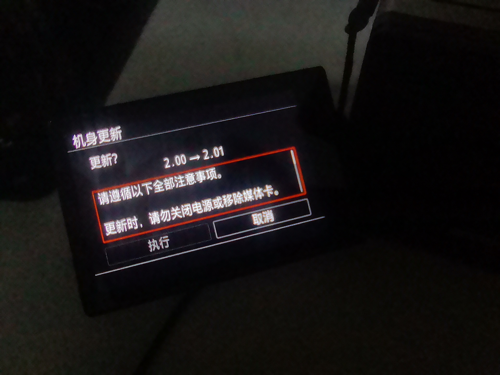

# CXD90057-CST

**CRC-Shell-Check** — 索尼 BIONZ XR（`CXD90057`）相机固件「壳」机制探讨。

目标机：Sony ILCE-6700（A6700），固件 **2.00**。

## 这个项目要解决什么

**核心问题是救砖**：相机刷坏之后，能不能在没有官方维修的情况下把它救回来。

要做到这件事，必须先回答三个问题：

1. **相机的更新链在哪一步会拦我？** → 识别层 / 执行层分离（本文实测）
2. **拦我的那道检查，能不能在没有私钥的情况下通过？** → 识别层不验 RSA（真机证实）
3. **如果我把相机搞坏了，有没有回退的路？** → R0–R4 阶梯 + WBI 快照头（本文整理）

本仓库给出的是这三个问题的**机制答案与验证数据**，
不是「一键救砖工具」——因为救砖的最后一公里（fastboot 写入 + 防砖保护）
依赖的硬件工具链仍在准备中。

> 详细路线见 [docs/04-rescue-plan.md](docs/04-rescue-plan.md)（分级 R0–R4）
> 与 [docs/08-rollback-and-ei-rampatch.md](docs/08-rollback-and-ei-rampatch.md)（回滚阶梯 + 防砖第一道闸）。

## 救砖思路的三条主线

### 主线 1：识别层不验签 —— 让相机「看见」你的固件

```
识别层  appFw.so     读 FdatHeader[32:34] 决定是否提示更新    ← 不验 RSA
执行层  nflasha1     updater 验 RSA-2048 后才写 flash        ← 验 RSA
```

**实测**：改 `versionMinor`（`0x00 → 0x01`）并重算全部可算校验后，
A6700（2.00）真机弹出了「**2.00 → 2.01**」的更新提示。
RSA 签名必然失效（无私钥），但识别层根本不看签名。

**这是救砖的基础**：只要能让相机「走到更新流程」，就有机会写回固件。

### 主线 2：版本号可以重算 —— 降级不被拦

索尼的更新链会做「新版本 > 当前版本」比较。但版本号就在
`FdatHeader[32:33]`（`versionMinor` / `versionMajor`），
而它受保护的三道校验（header CRC32 / L3 帧 / DEND CRC32）**全部可离线重算**。

**实测**：v2.00 → v2.01 重打包后，L0/L1/L2/L3 全层 `PASS`，
字节差异只有 2 个 4096 块（文件头 + DEND 区）。

**这意味着**：如果相机被刷到高版本又需要降级，
理论上可以构造一个「版本号更高但内容是旧版」的包 ——
**只要执行层的 RSA 能过**。而执行层 RSA 过不了，所以这条路用于「识别」而非「执行」。

### 主线 3：WBI 快照是双刃剑 —— 既是保护也是障碍

`nflasha5` 的前 512 B 是**启动快照头**（`WBI2` magic，1314 sections）：

| 状态 | 行为 | 对救砖的意义 |
|---|---|---|
| 快照有效 | 按「上次已知良好」加载 | ✅ 防砖（改坏了能回退） |
| 快照清零 | 按文件里的新布局加载 | ⚠️ 才能让改动生效，但也失去保护 |

**实测数据**（来自社区工具链 `Hxy-FireHydrant` 的模块）：
- `wbi rewrite`（写回原样 512 B）→ `verify=OK` 才说明**写通道可用**
- `wbi clear`（备份 + 清零）→ 改完必须**拔电池冷启动**
- `wbi restore`（写回备份）→ 恢复旧快照

**防砖第一道闸：`wbi rewrite` 的写通道自检。**
如果连原样数据都写不进去，任何改动都不要做。

### 救砖分级（当前状态）

| 级别 | 手段 | 需要 | 状态 |
|---|---|---|---|
| **R0** | SD 卡放官方包重新更新 | 相机能启动 | ✅ 可行 |
| **R1** | `up.sh ver` / `modver` | 相机 shell | ⚠️ 只影响识别层 |
| **R2** | fastboot 写 WBI 头 / 反向写 AP | USB 服务通道 + 工具链 | ❌ **工具在路上** |
| **R3** | 官方恢复包 | 索尼支持 | ✅ 兜底 |
| **R4** | 返厂 | — | ✅ 最后手段 |

**R2 是本文最有价值的部分**，也是**唯一还没跑通的部分** ——
因为 fastboot 工具只有读命令（`oem partition dump`），没有写命令。

> ⚠️ **免责声明 / Disclaimer**
>
> 本仓库是**逆向研究记录**，不是固件修改工具，也不是维修服务。
>
> - **不含**索尼固件、解密后的分区镜像、私钥或任何刷写工具
> - **不提供**刷机、降级或解锁任何相机的操作指引
> - 所有结论来自**对官方更新包的离线分析**与**对设备的只读查询**
> - 任何修改尝试都有变砖与失去保修的真实风险，作者不为此类后果承担责任
> - 商标与固件版权归索尼集团所有
>
> This repository is a **reverse-engineering research record**, not a firmware
> modification tool and not a repair service. It contains no Sony firmware,
> no decrypted partition images, no private keys, and no flashing tools. It
> does not provide instructions to flash, downgrade, or unlock any camera.
> All observations come from offline analysis of officially distributed
> update packages and from read-only device queries. Any modification attempt
> carries a real risk of bricking the device; the authors assume no liability.
> Trademarks and firmware copyrights belong to Sony Group Corporation.

---

## 文档导航 / Documentation

| 文档 | 内容 |
|---|---|
| [docs/01-container.md](docs/01-container.md) | UFU 容器与记录链 |
| [docs/02-crypto.md](docs/02-crypto.md) | 第四代 AesCbcCrypter |
| [docs/03-integrity.md](docs/03-integrity.md) | 三层校验（L1/L2/L3） |
| [docs/04-rescue-plan.md](docs/04-rescue-plan.md) | 救砖分级 R0–R4 |
| [docs/05-cxd90045-vs-cxd90057.md](docs/05-cxd90045-vs-cxd90057.md) | 两代机制演进 |
| [docs/06-rescue-and-ei.md](docs/06-rescue-and-ei.md) | fastboot 回滚思路、EI 补丁表 |
| [docs/07-platform-crossvalidation.md](docs/07-platform-crossvalidation.md) | 三平台对照（CXD90045 / CXD90057 / FX30 BK4） |
| [docs/08-rollback-and-ei-rampatch.md](docs/08-rollback-and-ei-rampatch.md) | 回滚阶梯、EI 的 RAM 补丁路径 |
| [docs/09-ap-mechanism.md](docs/09-ap-mechanism.md) | AP 机制、Powerful 实证、机型差异 |
| [docs/evidence/](docs/evidence/) | 真机验证照片与说明 |
| [HANDOFF.md](HANDOFF.md) | 项目交接记录（含未完成事项） |
| [GITHUB_RELEASE_PLAN.md](GITHUB_RELEASE_PLAN.md) | 本仓库的开源发布方案 |

---

## 结论摘要

| 层 | 机制 | 能否离线重算 |
|---|---|---|
| L0 | `UFU` 容器 / 记录链（DATV·PROV·UDID·FDAT·DEND） | 解析 ✅ |
| L1 | `DEND` 记录里的 **zlib CRC-32**，覆盖 `[0, N-12)`，大端 | **✅ 实测命中** |
| L2 | tar 内 `NN01_*_sum/*.sum` 文本清单，逐文件 CRC-32 | **✅ 88/88** |
| L3 | 每 1024 B 块的 `Σ(511 × u16le) & 0xFFFF` | **✅ bad=0** |
| — | **RSA-2048 签名**（PKCS#1 v1.5 / SHA-256，覆盖整个 FDAT 载荷） | ❌ 需公钥 |

**A6700 v2.00 实测**：

```
文件大小       1,024,017,848
FDAT 载荷      1,024,017,680  = 1,000,017 × 1024 + 272
L1 DEND        0xEABB5F09 == 0xEABB5F09        PASS
L3 帧          1,000,017 帧, bad=0, endflag=1  PASS
Header CRC32   0x5D0B3237 == 0x5D0B3237        PASS
L2 .sum        9 清单 / 88 条目 / 88 通过       PASS
版本           v2.00 (versionMajor=0x02, versionMinor=0x00)
机型码         model = 0x20030001
```

### 最重要的一条

**「识别」和「执行」是两个独立阶段，信任边界不同：**

- **识别**（菜单提示"发现新版本"）由 `appFw.so` 在正常运行环境完成 → **不验签名**（已实机确认）
- **执行**（点「执行」后）在 `nflasha1` 更新环境 → **验 RSA-2048**（文献确认）

所以：**"能弹出更新提示" ≠ "能刷进去"**。这一点在社区讨论里经常被混为一谈。

### 真机验证（2026-11-17 16:20）

把改动版 `BODYDATA.DAT` 放 SD 卡根目录，A6700（当前 2.00）开机后菜单弹出：

> **机身更新 / 更新? 2.00 → 2.01**



**仅拍摄此屏，未点击「执行」。** 这是「识别层不验 RSA」的直接证据。
详见 [docs/evidence/README.md](docs/evidence/README.md)。

### v2.00 → v2.01 重打包实测（2026-11-17）

改 `FdatHeader[32]`（`versionMinor` `0x00 → 0x01`），重算 header CRC32、第一帧 L3 校验、DEND CRC32：

```
原版 1,024,017,848 B  sha256 d3c7db5b…b847c  DEND EABB5F09
新版 1,024,017,848 B  sha256 c35a00da…f07be1  DEND 5F8FFD51
字节差异: 仅 2 个 4096 块（偏移 0x0 文件头、0x3d094000 DEND 区）
重校验: L0 ✅  L1 ✅ 5F8FFD51 == 5F8FFD51  L3 ✅ bad=0  header ✅ v2.01  L2 ✅ 88/88
VERDICT: PASS
```

**产物给真机后，菜单弹「发现新版本 2.01」** —— 这就是识别层不验签的直接证据。
RSA 签名必然失效（无私钥），所以此产物**不能用于执行更新**。

---

## 快速开始

需要 Python 3.13 + `pycryptodome`（反汇编另需 `capstone`）。
把官方 `BODYDATA.DAT` 放到仓库根目录（**本仓库不附带固件**）。

```powershell
# 1. 全层校验（L0+L1+L2+L3）
python src\cst_verify.py BODYDATA.DAT

# 2. 只改头部字段（不重算 L3/DEND）—— 仅用于离线研究，产物不能给相机
python src\cst_patch_header.py _work\test_v201.DAT 0x20:01   # versionMinor 0x00 -> 0x01

# 3. 解包内层（updater.img + tar 成员）
python tools\full_unpack.py
python tools\list_tar.py
python tools\verify_sums.py

# 4. 从 AP 根分区提取 appFw.so（需先有 _work/nflasha15.img）
python tools\dump_appfw.py
```

> **关于重打包**：`cst_repack_lossless.py` / `cst_repack_patch.py` / `cst_repack_v201.py`
> 三个脚本**暂不公开**。原因见 [docs/06-rescue-and-ei.md](docs/06-rescue-and-ei.md)：
> fastboot 写入 + 重打包的完整闭环尚未跑完，工具链还在路上。
> 重打包的**原理与数值**已在 `docs/03-integrity.md` 和 `docs/06-rescue-and-ei.md` 里说明，
> 任何人有官方固件都能自行复算。

`cst_verify.py` 会输出人类可读结果并写 `_work/verify_a6700.json`，`verdict` 字段为 `PASS` / `FAIL`。

---

## 目录

```
src/
  cst_verify.py           壳校验器（主工具，L0+L1+L2+L3 全层）
  cst_patch_header.py     FdatHeader 定点改写（轻量，不重算 L3/DEND）
  ext2.py                 ext2 只读解析（支持三间接块）
  parse_nflasha1.py       分区与镜像解析
tools/
  dump_appfw.py           提取 appFw.so 并比对 stock 哈希
  locate_string_owner.py  定位字符串归属文件
  full_unpack.py / list_tar.py / verify_sums.py / dend_check.py
  disasm_helper.py        AArch64 反汇编辅助
docs/
  01 容器 / 02 加密 / 03 校验 / 04 救砖规划 / 05 两代对比
  06 救砖与 EI 路线（fastboot 回滚思路、CineEI 补丁表）
  07 三平台交叉验证（CXD90045 / CXD90057 / FX30 BK4）
  08 回滚方案与 EI 的 RAM 补丁路径（含 EI 固件不下放的原因）
  09 AP 机制探讨（Powerful 实证、文件偏移 vs ELF VA、机型差异）
  evidence/               真机验证照片与说明
reference/                外部来源引用（不含第三方代码）
_work/                    产物输出（不入库）
_private/                 暂不公开的重打包脚本（.gitignore 排除）
```

---

## 关键常量（A6700 / CXD90057）

```
PAY_OFFSET   = 0x9C
FRAMES       = 1,000,017
KEY_ECB      = E3B0C44298FC1C149AFBF4C8996FB924          (key_aes, 跨代复用)
KEY_CBC(k8)  = 434589432D319010F1132727353286CE4D7EDE8B9C4F7217A0E0226E0F0EDC69
IV           = payload[-0x110 : -0x100]                  (载荷对齐，非文件对齐)
DEND         = file[N-12 : N]
```

> ⚠️ **IV 对齐陷阱**：`fwtool` 里 `seek(-0x110, 2)` 必须作用在 **FDAT 载荷切片**上。
> 若传整个 `.DAT`，会差 12 字节（DEND），症状是「只有 block0 后 512 B 校验失败、其余全过」
> （CBC 链特性，极隐蔽）。实测：`N-272 → ok=5 bad=1`；`N-284 → ok=6 bad=0`。

---

## 边界声明

- 本仓库**不含**索尼固件、解密后的分区镜像、私钥或任何刷写工具。
- 不提供绕过签名、刷机或修改相机的操作指引。
- 外部参考仓库的代码**不随本仓库分发**（见 `reference/README.md`），仅记录来源。
- 引用到的密钥来自已公开的上游项目，用于**格式研究与兼容性验证**。

已知风险（供使用者自行评估）：任何刷写类操作都存在变砖可能；
本文档记录的部分机制涉及 boot 分区，误操作不可逆。

---

## 致谢

完整清单见 **[ACKNOWLEDGEMENTS.md](ACKNOWLEDGEMENTS.md)**。核心来源：

- [`Lost-week-1025/CXD90045-FPSU`](https://github.com/Lost-week-1025/CXD90045-FPSU) — CXD90045 三层校验与 CRC 破解（本文档 CXD90045 数据来源）
- [`Hearts-Ace/sony-a7r5-custom-firmware`](https://github.com/Hearts-Ace/sony-a7r5-custom-firmware) — CXD90057 密钥与签名规范
- [`ivica00/sony-a6400-research`](https://github.com/ivica00/sony-a6400-research)（MIT）— CXD90045 平台证据链
- [`DevCrashDay/a6400`](https://github.com/DevCrashDay/a6400) — A6400 开机 hook（无 LICENSE，仅引用机制）
- [`PCIEARIA/A6400-Extra-Menu`](https://github.com/PCIEARIA/A6400-Extra-Menu) — 注入方式对照
- [`xyzhangxin/sony-a6700-powerful`](https://github.com/xyzhangxin/sony-a6700-powerful) — A6700 fastboot 只读工具链
- [`Himpq/FireHydrant`](https://github.com/Himpq/FireHydrant) — CineEI 工程化探索
- [`chocotan/a7c2-qemu`](https://github.com/chocotan/a7c2-qemu) / [`Lincan19540/fx30-firmware-research`](https://github.com/Lincan19540/fx30-firmware-research) — 同 SOC QEMU 与 BK4 设置容器方法

> 上游代码不随本仓库分发，仅引用结论与方法。Sony 固件本体永不入库。
